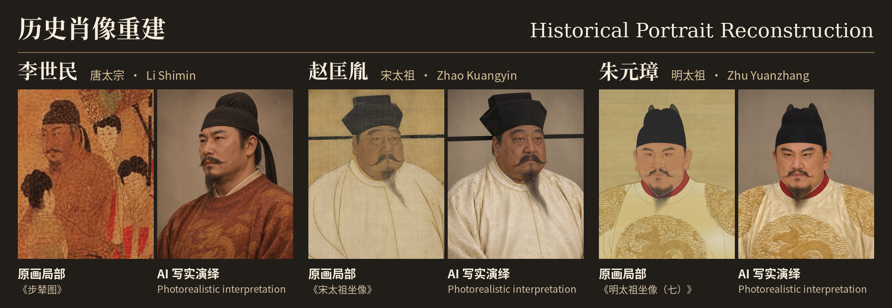

# historical-portrait-reconstruction



[Banner artwork and full images](THIRD_PARTY_NOTICES.md#readme-banner)

**Historical painting → source-grounded photorealistic portrait → authentic side-by-side comparison.**

[中文说明](README.zh-CN.md) · [Skill](skills/historical-portrait-reconstruction/SKILL.md) · [Examples](examples/) · [Contributing](CONTRIBUTING.md)

## Use it

Ask an agent that has this skill and a reference-image generation tool:

> Reconstruct Qin Shi Huang from the best traceable portrait available. Verify the artwork's date and identity, preserve its visible facial features and pose, and deliver the authentic painting on the left with the photorealistic interpretation on the right. State the limits of a later depiction.

Or run a batch:

> Process the Ming emperors in the supplied list. Use a separate source and facial-feature record for each person. Deliver one final source-versus-interpretation comparison per person, with a complete status list.

The final comparison is mandatory. The source panel uses the acquired image file, placed by a deterministic script. A generator must not redraw it.

## What this project does

This skill guides an agent through source selection, visual observation, reference-conditioned generation, composition, and review. It aims to preserve the distinctions present in each source painting.

| Stage | Required result |
| --- | --- |
| Source | Traceable artwork, object identifier when available, work date, identity basis, image URL and rights record |
| Observation | Person-specific visible features; uncertain or hidden details recorded separately |
| Generation | The actual reference image supplied to a capable image-generation backend |
| Composition | Authentic source at left, generated interpretation at right; documented crop and proportional scaling |
| Review | Comparison with that person's source, cross-person checks, complete batch accounting |

**Similarity to a painting does not establish similarity to the historical person.** The output is an artistic interpretation of visual evidence. It is not a forensic reconstruction or a measured historical likeness.

## Install the skill

The reusable folder is `skills/historical-portrait-reconstruction/`. It follows the [Agent Skills format](https://agentskills.io/specification).

### Claude Code, local terminal sessions

The following uses Claude Code's documented personal skill location, checked on **2026-11-18**. Consult the [official skills documentation](https://code.claude.com/docs/en/skills) for your client version.

```bash
git clone https://github.com/TimeCracker/historical-portrait-reconstruction.git
cd historical-portrait-reconstruction
mkdir -p "$HOME/.claude/skills"
cp -R skills/historical-portrait-reconstruction "$HOME/.claude/skills/"
```

For a first installation, copy the whole folder. If a same-named skill already exists, review the changes before replacing it. Invoke it in Claude Code with:

```text
/historical-portrait-reconstruction Reconstruct the person in this painting and produce a side-by-side comparison.
```

A project installation can instead use `.claude/skills/historical-portrait-reconstruction/` inside your project. Other Agent Skills clients need their own supported import or discovery method.

**Loading the instructions does not supply an image-generation service.** The host needs image viewing, reference-image generation, and a way to execute the compositor. This repository includes no image-model weights, API credentials, or automatic backend adapter. Client installation instructions are not an end-to-end compatibility guarantee.

## Run the compositor

The compositor combines **two existing images**. It does not generate a face or download source material.

Requirements: **Python 3.11+** and **Pillow 13.x**. The development runtime used here is Python **3.12.14** with Pillow **13.0.0**; other combinations are not claimed as tested.

From the repository root:

```bash
python3 -m venv .venv
. .venv/bin/activate
python -m pip install -r requirements.txt
python skills/historical-portrait-reconstruction/scripts/compose_comparison.py --help
```

The activation command above is for macOS/Linux shells. On another platform, activate the virtual environment using that platform's Python instructions.

### One person

Supply your own acquired source and generated portrait files:

```bash
python skills/historical-portrait-reconstruction/scripts/compose_comparison.py \
  --source input/source.jpg \
  --portrait input/portrait.png \
  --output output/comparison.png \
  --title "Qin Shi Huang" \
  --caption "Later painted depiction; historical likeness is not verified."
```

Optional controls include `--crop X0 Y0 X1 Y1`, `--portrait-crop X0 Y0 X1 Y1`, `--panel-width`, `--panel-height`, `--source-label`, `--portrait-label`, and `--font`. Crops use integer pixel coordinates on the decoded input image; the right and bottom edges are exclusive. Use the same pose on both sides whenever the reference allows it.

For Chinese labels, provide a CJK-capable font with `--font /path/to/font.ttf` if automatic discovery does not find one. Fonts are not bundled.

The command writes:

- `output/comparison.png`: the two-panel image.
- `output/comparison.json`: hashes and composition provenance.

Hashes identify the input bytes; they do not validate the artwork's attribution or the generated likeness.

### A batch

Save this as `jobs.json`, then supply the files it names:

```json
{
  "items": [
    {
      "id": "person-one",
      "source": "input/person-one-source.jpg",
      "portrait": "input/person-one-portrait.png",
      "output": "output/person-one.png",
      "title": "Person one",
      "caption": "Source-grounded interpretation; historical likeness is not verified."
    }
  ]
}
```

```bash
python skills/historical-portrait-reconstruction/scripts/compose_comparison.py \
  --manifest jobs.json
```

Manifest paths resolve relative to the manifest's directory. Each item needs a unique `id`, `source`, `portrait`, and `output`. Add optional text, crop, or font settings per item. The default batch report is `batch_report.json` beside the manifest; `--report` selects another report path. Inspect it and the process exit status before treating the batch as complete.

The workflow has no fixed ten-person limit. Backend limits or failures must be recorded as actual run conditions, and unfinished people must remain visible in the status list.

## Evidence and review rules

- Inspect the source image itself, including the face. A catalog description alone is insufficient.
- Separate the person's lifetime from the artwork's production date.
- Treat copies derived from one original as a shared source lineage.
- Preserve the reference pose by default. Identify inferred areas if another view is requested.
- Lock visible facial features per person. Shared clothing and lighting must not turn different people into one face template.
- Keep literary descriptions and personality claims from becoming invented anatomy.
- Review the finished comparison, not just the generated portrait.
- Report uncertainty in the sources separately from visual fidelity to the painting.

Detailed execution rules are in [SKILL.md](skills/historical-portrait-reconstruction/SKILL.md).

## Examples and images

- [Qin Shi Huang](examples/qin-shi-huang/): source record, observation-based prompt, and composition manifest.
- [Ming emperors](examples/ming-portraits/): sixteen source records and a batch manifest.

The initial examples are **metadata-only**. Downloaded historical scans and generated portrait binaries are not bundled. Example manifests identify the files a user must supply; they are not complete, runnable image datasets.

Every third-party image keeps its own rights statement. See [THIRD_PARTY_NOTICES.md](THIRD_PARTY_NOTICES.md).

## Development

Run the local compositor tests from the repository root:

```bash
python -m unittest discover -s tests -v
```

These tests cover deterministic image handling and batch behavior. They do not measure historical truth or image-model identity preservation.

On 2026-11-18, all 13 tests passed in the environment above, including pixel comparison of the source panel, unchanged input hashes, a 12-person batch from another working directory, and partial-save failure reporting.

## License

Original skill instructions, scripts, and repository documentation are provided under the [MIT License](LICENSE), to the extent the contributors can license them. Third-party images, fonts, dependencies, and service outputs keep their respective terms.

See [CHANGELOG.md](CHANGELOG.md) for release changes and [CONTRIBUTING.md](CONTRIBUTING.md) for evidence and code contributions.

